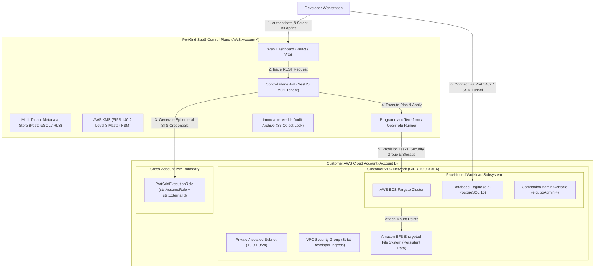
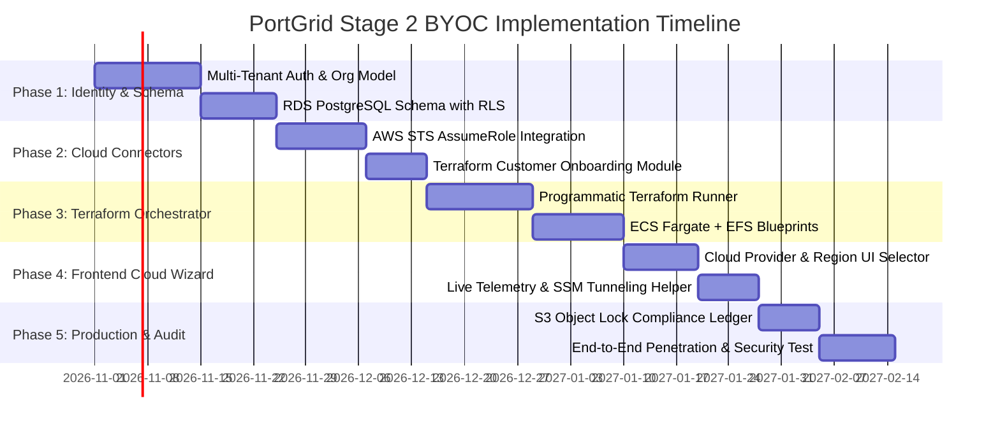

# PortGrid Bring Your Own Cloud (BYOC) Architecture Specification

## 1. Executive Summary and Problem Statement

PortGrid BYOC (Bring Your Own Cloud) is a decentralized cloud architecture where the PortGrid platform operates a centralized multi-tenant Control Plane, while all computational workloads, database engines, persistent disks, and network interfaces run inside the customer's own cloud infrastructure (such as AWS, GCP, or Azure).

### Why BYOC is the Enterprise Standard
1. **Data Sovereignty and Zero Trust:** Customer data never touches PortGrid's servers. Databases remain strictly within the customer's private VPC subnets.
2. **Regulatory Compliance (SOC 2, ISO 27001, HIPAA, PCI-DSS):** Enterprises can run isolated developer and staging infrastructure while satisfying strict corporate compliance requirements.
3. **Cloud Billing Optimization:** Compute and storage costs are billed directly to the customer's existing cloud provider accounts, allowing them to utilize committed spend discounts and reserved instances.
4. **No Vendor Lock-In:** Workloads run as standard OCI container images on managed cloud services with native volume storage.

---

## 2. High-Level Architectural Topology



---

## 3. Threat Model and Security Architecture

### 3.1 Confused Deputy Mitigation via AWS STS ExternalId
In a multi-tenant SaaS architecture where a central service assumes IAM roles in third-party AWS accounts, the Confused Deputy problem is a critical attack vector: an attacker might trick the SaaS provider into assuming another customer's IAM role.

**PortGrid Enforcement Mechanism:**
- Each registered organization is assigned an immutable, cryptographically generated 256-bit UUID `external_id`.
- The customer's IAM trust policy strictly enforces:
  ```json
  "Condition": {
    "StringEquals": {
      "sts:ExternalId": "urn:portgrid:org:<organization-uuid>"
    }
  }
  ```
- Any STS AssumeRole request without this specific `ExternalId` is rejected by AWS IAM at the cryptographic evaluation level.

### 3.2 Ephemeral Credential Lifecycle (Zero Static Secrets)
- PortGrid never stores long-lived customer AWS Access Keys or Secret Keys.
- When an operation is initiated, the PortGrid Control Plane invokes `sts:AssumeRole` using PortGrid's IAM identity.
- AWS returns short-lived temporary security credentials with an expiration window of 15 to 60 minutes:
  - `AccessKeyId`
  - `SecretAccessKey`
  - `SessionToken`
- Credentials exist solely in volatile process memory and are zeroed immediately upon task completion.

### 3.3 Data Encryption at Rest and in Transit
- **Control Plane Secrets:** Cloud connection metadata and database passwords stored in PortGrid are encrypted using FIPS 140-2 Level 3 AWS KMS envelope encryption with AES-256-GCM.
- **Customer Storage:** Amazon EFS and EBS volumes created in the customer's account are encrypted using the customer's default AWS KMS key (`aws/elasticfilesystem` or a customer-managed key).
- **Transport Security:** All control plane communications enforce TLS 1.3 with strict Forward Secrecy cipher suites.

### 3.4 Maker-Checker Governance and Cryptographic Shredding
- Destructive operations (such as decommissioning a database cluster or purging an EFS volume) cannot be performed unilaterally.
- A Maker submits a teardown ticket (`#TKT-XXXX`).
- An authorized Checker in the organization reviews the target ARN and approves the action.
- PortGrid executes NIST SP 800-88 cryptographic shredding: compute tasks are drained, volumes are deleted with verifiable receipts, and an immutable record is appended to the SHA-256 Merkle audit trail.

---

## 4. The Role of Terraform and OpenTofu in PortGrid BYOC

### Can We Use Terraform?
**Yes, absolutely.** Terraform (and OpenTofu) is the industry standard for infrastructure as code. In PortGrid BYOC, Terraform is used in two distinct contexts:

1. **Control Plane Infrastructure (PortGrid Management):**
   - Manages PortGrid's own hosted multi-tenant infrastructure on AWS: Application Load Balancer (ALB), ECS Fargate Control Plane tasks, Amazon RDS PostgreSQL (with Row-Level Security), AWS KMS keys, and S3 Object Lock audit buckets.

2. **Customer Onboarding Module (Customer-Facing):**
   - A standardized, open-source Terraform module (`terraform-aws-portgrid-access`) that customers review and apply in their AWS accounts in under two minutes to establish the cross-account trust boundary.

3. **Dynamic Workload Provisioning Engine (Runtime Execution):**
   - PortGrid executes modular Terraform recipes programmatically to spin up ECS Fargate tasks, Security Groups, EFS storage access points, and companion containers inside the customer account.
   - Terraform manages state files encrypted in Amazon S3 per organization, providing deterministic drift detection, idempotent updates, and clean teardowns.

---

## 5. Step-by-Step Technical Implementation Blueprint

### Step 1: Customer AWS Onboarding via Terraform Module

The customer applies the following Terraform module in their AWS account:

```hcl
# customer-account/main.tf
module "portgrid_access" {
  source = "github.com/portgrid/terraform-aws-portgrid-access?ref=v1.0.0"

  portgrid_aws_account_id = "123456789012" # PortGrid SaaS Account ID
  organization_external_id = "urn:portgrid:org:c76c38d4-111f-4b6f-9ffc-c63be5730f00"

  allowed_regions = ["us-east-1", "eu-west-1", "ap-southeast-1"]
  enable_efs_provisioning = true
  enable_ecs_fargate_provisioning = true
}

output "role_arn" {
  value = module.portgrid_access.role_arn
}
```

#### Underlying IAM Role and Least Privilege Policy:

```hcl
# terraform-aws-portgrid-access/role.tf
resource "aws_iam_role" "portgrid_execution" {
  name = "PortGridExecutionRole"

  assume_role_policy = jsonencode({
    Version = "2012-10-17"
    Statement = [
      {
        Effect = "Allow"
        Principal = {
          AWS = "arn:aws:iam::${var.portgrid_aws_account_id}:root"
        }
        Action = "sts:AssumeRole"
        Condition = {
          StringEquals = {
            "sts:ExternalId" = var.organization_external_id
          }
        }
      }
    ]
  })
}

resource "aws_iam_policy" "portgrid_scoped_policy" {
  name = "PortGridScopedPermissions"

  policy = jsonencode({
    Version = "2012-10-17"
    Statement = [
      {
        Effect = "Allow"
        Action = [
          "ecs:CreateCluster",
          "ecs:DescribeClusters",
          "ecs:RegisterTaskDefinition",
          "ecs:DeregisterTaskDefinition",
          "ecs:RunTask",
          "ecs:StopTask",
          "ecs:DescribeTasks"
        ]
        Resource = "*"
      },
      {
        Effect = "Allow"
        Action = [
          "ec2:DescribeVpcs",
          "ec2:DescribeSubnets",
          "ec2:DescribeSecurityGroups",
          "ec2:CreateSecurityGroup",
          "ec2:AuthorizeSecurityGroupIngress",
          "ec2:RevokeSecurityGroupIngress",
          "ec2:DeleteSecurityGroup"
        ]
        Resource = "*"
      },
      {
        Effect = "Allow"
        Action = [
          "elasticfilesystem:CreateFileSystem",
          "elasticfilesystem:DescribeFileSystems",
          "elasticfilesystem:CreateAccessPoint",
          "elasticfilesystem:DeleteAccessPoint",
          "elasticfilesystem:DeleteFileSystem"
        ]
        Resource = "*"
      },
      {
        Effect = "Allow"
        Action = [
          "logs:CreateLogGroup",
          "logs:CreateLogStream",
          "logs:PutLogEvents",
          "logs:GetLogEvents"
        ]
        Resource = "arn:aws:logs:*:*:log-group:/portgrid/*"
      }
    ]
  })
}

resource "aws_iam_role_policy_attachment" "attach_scoped" {
  role       = aws_iam_role.portgrid_execution.name
  policy_arn = aws_iam_policy.portgrid_scoped_policy.arn
}
```

---

### Step 2: Multi-Tenant Data Layer and Storage Schema

PortGrid utilizes a multi-tenant PostgreSQL metadata schema with PostgreSQL Row-Level Security (RLS) to enforce total data isolation across customer organizations:

```sql
-- Multi-Tenant Organizations
CREATE TABLE organizations (
    id UUID PRIMARY KEY DEFAULT gen_random_uuid(),
    name VARCHAR(255) NOT NULL,
    external_id VARCHAR(255) UNIQUE NOT NULL,
    created_at TIMESTAMPTZ DEFAULT NOW(),
    updated_at TIMESTAMPTZ DEFAULT NOW()
);

-- Cloud Provider Connections
CREATE TABLE cloud_connections (
    id UUID PRIMARY KEY DEFAULT gen_random_uuid(),
    organization_id UUID NOT NULL REFERENCES organizations(id) ON DELETE CASCADE,
    provider VARCHAR(50) NOT NULL, -- 'AWS', 'GCP', 'AZURE'
    role_arn VARCHAR(255) NOT NULL,
    default_region VARCHAR(50) NOT NULL,
    status VARCHAR(50) NOT NULL, -- 'VERIFIED', 'FAILED', 'REVOKED'
    last_verified_at TIMESTAMPTZ,
    created_at TIMESTAMPTZ DEFAULT NOW()
);

-- Cloud Service Instances
CREATE TABLE cloud_instances (
    id UUID PRIMARY KEY DEFAULT gen_random_uuid(),
    organization_id UUID NOT NULL REFERENCES organizations(id) ON DELETE CASCADE,
    cloud_connection_id UUID NOT NULL REFERENCES cloud_connections(id),
    blueprint_id VARCHAR(100) NOT NULL,
    service_name VARCHAR(255) NOT NULL,
    region VARCHAR(50) NOT NULL,
    compute_provider VARCHAR(50) NOT NULL, -- 'AWS_ECS_FARGATE', 'AWS_EC2'
    task_arn VARCHAR(255),
    private_ip VARCHAR(50),
    public_endpoint VARCHAR(255),
    encrypted_credentials_envelope JSONB NOT NULL,
    status VARCHAR(50) NOT NULL, -- 'PROVISIONING', 'RUNNING', 'STOPPED', 'TEARING_DOWN'
    created_at TIMESTAMPTZ DEFAULT NOW(),
    updated_at TIMESTAMPTZ DEFAULT NOW()
);

-- Row-Level Security Policies
ALTER TABLE cloud_instances ENABLE ROW LEVEL SECURITY;

CREATE POLICY tenant_isolation_policy ON cloud_instances
    FOR ALL
    USING (organization_id = NULLIF(current_setting('app.current_organization_id', true), '')::UUID);
```

---

### Step 3: STS AssumeRole Connector Service

The NestJS backend implements the STS Connector using `@aws-sdk/client-sts`:

```typescript
import { Injectable, Logger, UnauthorizedException } from '@nestjs/common';
import { STSClient, AssumeRoleCommand } from '@aws-sdk/client-sts';

export interface EphemeralAwsCredentials {
  accessKeyId: string;
  secretAccessKey: string;
  sessionToken: string;
  expiration: Date;
}

@Injectable()
export class CloudCredentialsService {
  private readonly logger = new Logger(CloudCredentialsService.name);
  private readonly stsClient = new STSClient({ region: 'us-east-1' });

  async assumeCustomerRole(
    roleArn: string,
    externalId: string,
    sessionName: string = 'PortGridDeploymentSession',
  ): Promise<EphemeralAwsCredentials> {
    try {
      const command = new AssumeRoleCommand({
        RoleArn: roleArn,
        RoleSessionName: sessionName,
        ExternalId: externalId,
        DurationSeconds: 1800, // 30-minute ephemeral lease
      });

      const response = await this.stsClient.send(command);

      if (!response.Credentials?.AccessKeyId || !response.Credentials?.SecretAccessKey) {
        throw new Error('Incomplete credentials returned from AWS STS');
      }

      this.logger.log(`Successfully assumed role: ${roleArn}`);

      return {
        accessKeyId: response.Credentials.AccessKeyId,
        secretAccessKey: response.Credentials.SecretAccessKey,
        sessionToken: response.Credentials.SessionToken!,
        expiration: response.Credentials.Expiration!,
      };
    } catch (err: any) {
      this.logger.error(`STS AssumeRole failed for ${roleArn}: ${err.message}`);
      throw new UnauthorizedException(`Cloud authentication failed: ${err.message}`);
    }
  }
}
```

---

### Step 4: Programmatic Workload Provisioning Recipe (ECS Fargate + EFS)

When deploying a blueprint (such as PostgreSQL 16), PortGrid generates and executes a scoped Terraform configuration against the customer's account using the temporary STS credentials:

```hcl
# Generated dynamically per deployment
terraform {
  required_providers {
    aws = {
      source  = "hashicorp/aws"
      version = "~> 5.0"
    }
  }
}

provider "aws" {
  region = var.target_region
  access_key = var.ephemeral_access_key
  secret_key = var.ephemeral_secret_key
  token      = var.ephemeral_session_token
}

# 1. Isolated EFS Storage for Database Durability
resource "aws_efs_file_system" "db_storage" {
  creation_token = "portgrid-storage-${var.instance_id}"
  encrypted      = true

  tags = {
    Project        = "PortGrid"
    OrganizationId = var.organization_id
    InstanceId     = var.instance_id
  }
}

resource "aws_efs_access_point" "db_access_point" {
  file_system_id = aws_efs_file_system.db_storage.id

  posix_user {
    gid = 999 # Standard Postgres user
    uid = 999
  }

  root_directory {
    path = "/data"
    creation_info {
      owner_gid   = 999
      owner_uid   = 999
      permissions = "0700"
    }
  }
}

# 2. Scoped Security Group with Restricted Ingress
resource "aws_security_group" "service_sg" {
  name        = "portgrid-sg-${var.instance_id}"
  description = "PortGrid ephemeral ingress for ${var.instance_id}"
  vpc_id      = var.customer_vpc_id

  ingress {
    description = "Developer Workstation Allowed IP"
    from_port   = 5432
    to_port     = 5432
    protocol    = "tcp"
    cidr_blocks = [var.developer_public_ip_cidr] # e.g. "203.0.113.45/32"
  }

  egress {
    from_port   = 0
    to_port     = 0
    protocol    = "-1"
    cidr_blocks = ["0.0.0.0/0"]
  }
}

# 3. ECS Fargate Task Definition with Paired Admin Console
resource "aws_ecs_task_definition" "db_task" {
  family                   = "portgrid-${var.instance_id}"
  network_mode             = "awsvpc"
  requires_compatibilities = ["FARGATE"]
  cpu                      = "1024"
  memory                   = "2048"
  execution_role_arn       = var.ecs_execution_role_arn

  volume {
    name = "db_data"
    efs_volume_configuration {
      file_system_id     = aws_efs_file_system.db_storage.id
      transit_encryption = "ENABLED"
      authorization_config {
        access_point_id = aws_efs_access_point.db_access_point.id
      }
    }
  }

  container_definitions = jsonencode([
    {
      name      = "postgres"
      image     = "postgres:16-alpine"
      essential = true
      portMappings = [
        {
          containerPort = 5432
          hostPort      = 5432
        }
      ]
      environment = [
        { name = "POSTGRES_DB", value = "app" },
        { name = "POSTGRES_USER", value = var.generated_user },
        { name = "POSTGRES_PASSWORD", value = var.generated_password }
      ]
      mountPoints = [
        {
          sourceVolume  = "db_data"
          containerPath = "/var/lib/postgresql/data"
        }
      ]
    }
  ])
}
```

---

### Step 5: Secure Client Access Architecture

To connect developer workstations to databases deployed in the customer's AWS VPC, PortGrid provides three secure access tiers:

| Tier | Connectivity Mechanism | Network Route | Security Profile |
| :--- | :--- | :--- | :--- |
| **Tier 1 (Default)** | **Public IP with Strict CIDR Ingress** | Traffic routes over TLS directly to Fargate Public IP on port 5432. | Security group dynamically whitelists the developer's `/32` public IP. |
| **Tier 2 (Zero-Trust)** | **Tailscale / WireGuard Subnet Router** | Traffic routes over encrypted WireGuard overlay mesh (`100.x.y.z`). | No public IPs. VPC has zero internet-facing ports. |
| **Tier 3 (Cloud-Native)** | **AWS SSM Session Port Forwarding** | Traffic tunnels through AWS Systems Manager: `aws ssm start-session`. | Fully authenticated through customer AWS IAM. Zero open ingress ports. |

---

### Step 6: NIST SP 800-88 De-Provisioning and Cryptographic Shredding

When a service is torn down:
1. **Maker-Checker Validation:** Destructive action ticket approved by designated Checker.
2. **Compute Drain:** ECS task stopped and task definition deregistered.
3. **Volume Purging:** EFS access points deleted; EFS file system purged.
4. **Credential Erasure:** In-memory credential variables zeroed (`Buffer.fill(0)`), and encrypted envelopes in RDS marked as destroyed.
5. **Merkle Block Ingestion:** Audit block signed with SHA-256 and pushed to the immutable audit ledger.

---

## 6. Implementation Roadmap and Milestones



---

## 7. Cost Model Comparison

| Component | PortGrid Hosted Cost | Customer AWS Cost (Paid via Customer Billing) |
| :--- | :--- | :--- |
| **Control Plane** | ~$40 - $70 / month (ALB, Fargate, RDS PostgreSQL Multi-AZ). | $0 |
| **Ephemeral Databases** | $0 (Workloads run in customer account). | ~$0.01 - $0.04 / hour per active Fargate task (cents per day for dev work). |
| **EFS Persistent Storage** | $0 | ~$0.30 / GB-month (fractions of a cent for dev databases). |
| **Data Transfer** | Minimal API telemetry payload. | Standard AWS egress rates. |
